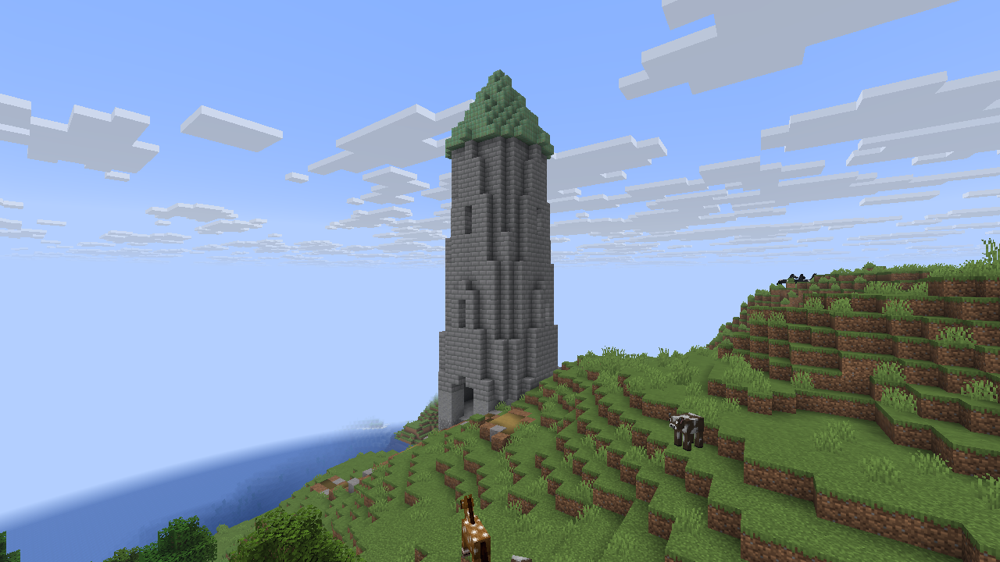

# Minecraft World Studio

A local creative building lab for Minecraft Java 26.3. The player builds in Axiom and talks to Codex through a project-scoped MCPFabric connection. WorldEdit supplies player-context bulk edits. The prototype includes a revisable watchtower, five stone texture samples, a collaborative gate fixture and timed editing trials.



## Open the lab

From this directory in PowerShell 7, start the installed client. The launcher uses the private `WorldStudioLab` save and the local player `WorldStudio`.

```powershell
.\scripts\Start-Client.ps1
```

For in-game collaboration, start the listener from a second PowerShell terminal.

```powershell
.\scripts\Start-Chat.ps1 -Background
```

When **Studio ready** appears in Minecraft, try `@studio make the hillside watchtower roof two blocks taller`. The request applies immediately. To see a particle guide first, start the request with `@studio preview`. Use `@studio undo` for a checked reversal. [Chat commands and recovery](docs/in-game-building.md)

For the full MCP toolset, open **this repository** as a Codex project, or run `codex` from a second terminal in the repository. In a new conversation, try:

> Use World Studio to inspect my position and the block I’m looking at. Show me a short in-game message describing the site. Wait for me before building.

Start with `agent_brief` and `get_self`. Check for `sp:WorldStudioLab`, the Overworld and Creative mode. For a player-only reply, use `show_message`. In-game messages are readable during an active Codex turn. The separate listener starts a design turn when the local player addresses `@studio`.

Use `send_chat` with the normal WorldEdit command text when the edit should use the player's clipboard, selection or history. For an AI-owned WorldEdit session, the console route worked after an explicit world override. [Exact commands and readback](docs/console-worldedit.json) Check block states afterward. For the gallery fixtures start in their empty reserved plots on a fresh save. Several intentionally reject a second run over the completed build.

## Connect and recover

```powershell
codex mcp get worldstudio
python .\scripts\check_codex.py --capture
```

The first command checks the registration. The second starts a fresh local Codex app-server, lists the curated tools, reads the current game and retrieves a framebuffer into `local/codex-frame.png`. It needs Python 3 and a running client. A closed game produces a bridge error, while the stdio server can still list tools. Closing Codex closes that stdio process. Save and quit Minecraft to close the game. The [installation guide](docs/installation.md) covers the launcher, fresh installs and backups.

Private runtime files, world backups, tokens, SQLite data and downloaded binaries live in the ignored `local/` directory. The project-specific `.codex/config.toml` is generated locally. The installer preserves other entries and stops on a conflicting registration. The stock server comes from the [pinned MCPFabric release](https://github.com/denfry/mcpfabric/releases/tag/v0.10.0).

## Results

| Question | Evidence |
| --- | --- |
| What worked, and what should we build next? | [Evaluation and decisions](docs/evaluation-report.md) |
| How do I reproduce the installation or test the manual interaction? | [Installation](docs/installation.md) · [Playtest](docs/playtest.md) |
| What can Codex see and do? | [Tool inventory](docs/mcp-tool-inventory.md) · [Complete wire schemas](docs/tools-all.json) · [Real Codex turn](docs/codex-model-smoke.json) · [Screenshot-to-chat test](docs/codex-visual-chat.json) |
| How are permission checks, scripts and storage implemented? | [Pinned source review](docs/source-review.md) · [Script runtime checks](docs/script-contract.json) |
| How does the tower change, and how do the walls look? | [Experiments and performance](docs/experiments.md) · [Gallery](screenshots/) · [Raw timings](benchmarks/results/trials.jsonl) |
| Which pieces should we reuse for collaborative revisions? | [Architecture](docs/architecture.md) · [Ecosystem and artistic references](docs/ecosystem.md) |
