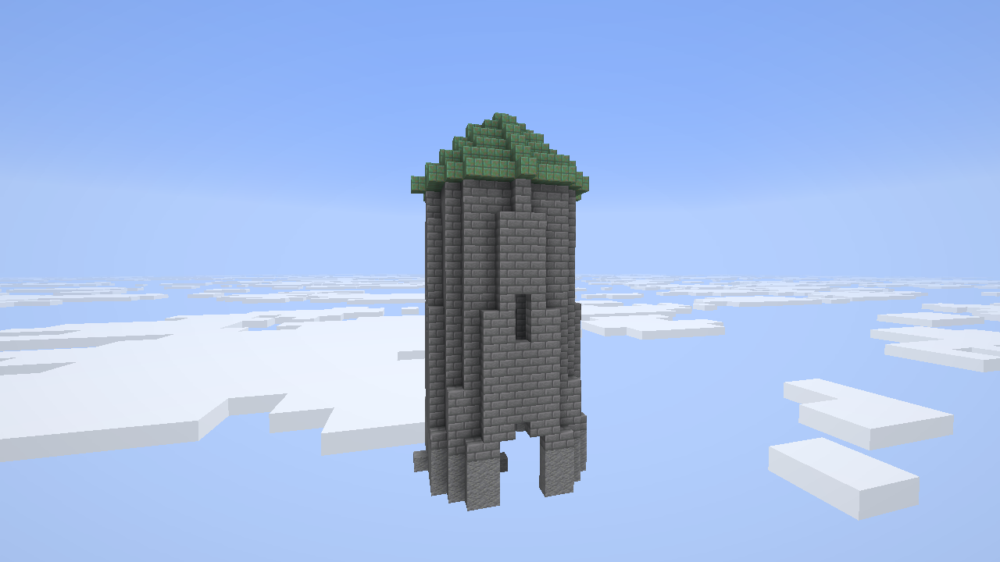
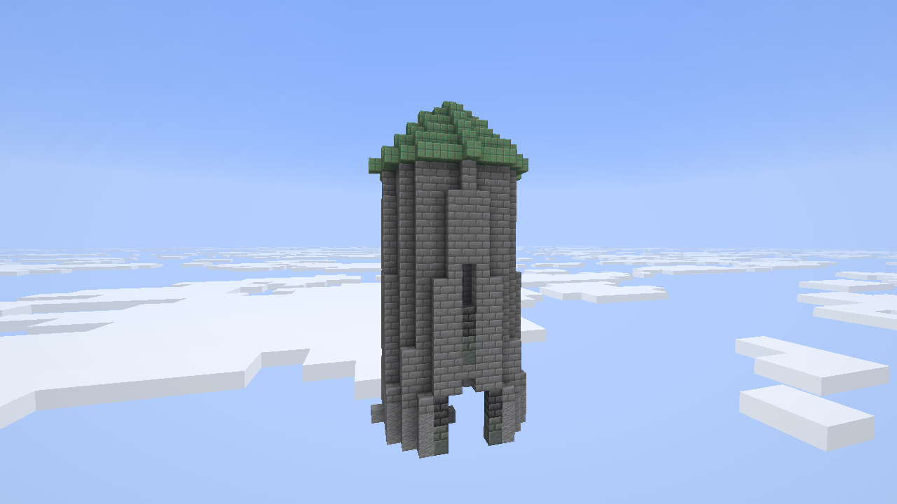
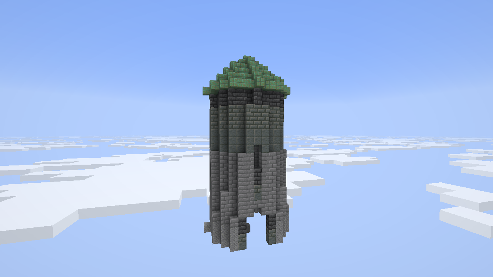
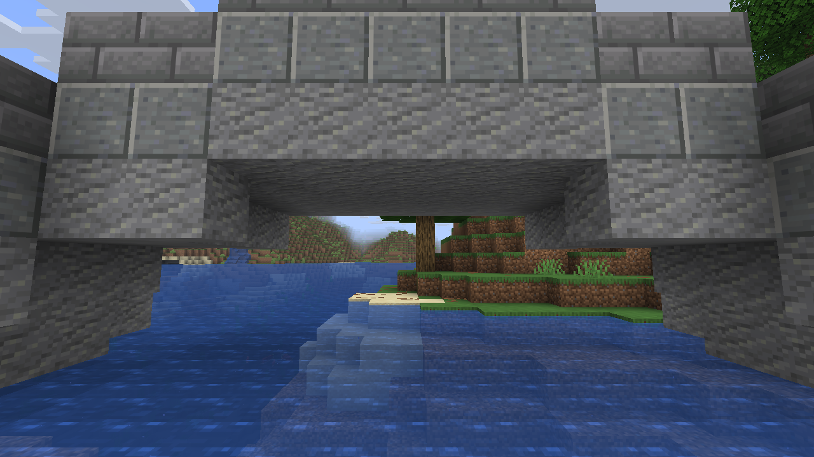
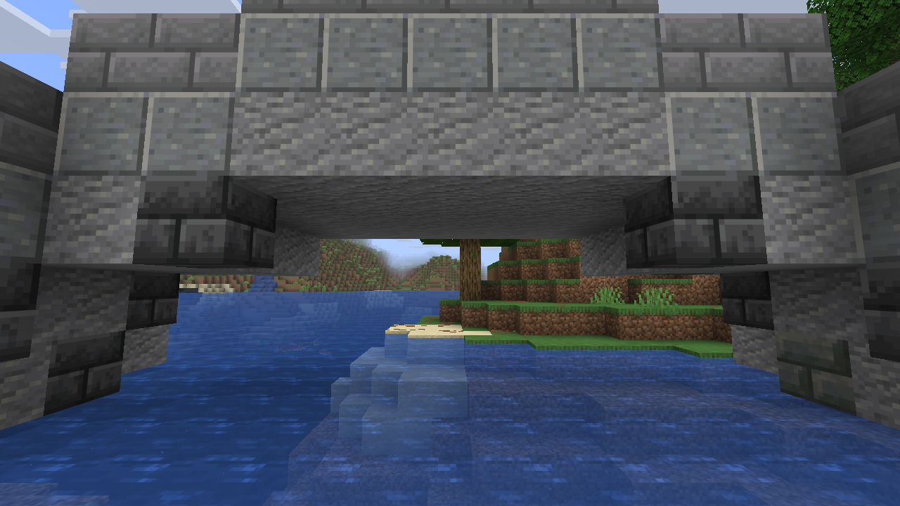
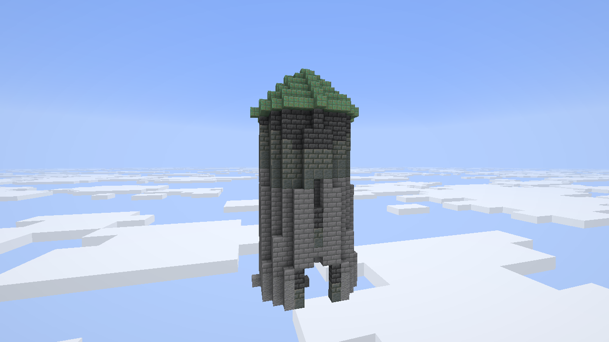

# Milestone 3 — Artistic intelligence

## First slice · Weathered bridge stone

Aim at a registered Studio bridge and use **J → Ask Studio…**. You can also identify a bridge by its two bank names.

1. Ask **“Give this bridge darker, weathered stone near the waterline. Keep the upper stonework lighter and the walking surface quiet. Preserve the shape and my hand-placed blocks.”**
2. Ask **“Make the weathering subtler.”** The strongest parts of the original patches remain, with more of the original stone showing through.
3. Use **@studio undo** to return to the stronger finish. A second undo restores the original stone where the live blocks still match Studio’s work.

The first paint pass surveys water below the actual deck. Low masonry takes on dark tuff brick and polished tuff, while smooth stone catches the light higher up. A shared noise field gives neighboring blocks related values and keeps the patches in place between revisions. The walking lane keeps its original material. Both finishes use the original coordinates and can be exported with the registered bridge. [Material selection](../packages/geometry/materials.ts) · [Building and exporting a bridge](milestone-2.md)

The survey checks down to eight blocks below the lower landing. The most frequently observed exposed water elevation becomes the reference for this bridge. A dry crossing gets a quieter foundation treatment. Studio saves the sampled elevation with the finish so later edits can reproduce it.

### River crossing playtest

Studio built the bridge through chat and found water at Y62. The full finish changed 58 of its 218 placed blocks. Tuff bricks and polished tuff averaged Y63.3, while smooth stone averaged Y67.1. The subtler pass kept 16 of those accents in place and restored 42 blocks to their original material. Both undos preserved the cut copper at the west landing. The fixture placed that block with a conditional Minecraft command to simulate a hand edit. An independent readback checked all 4,914 cells after each revision and confirmed the river was restored after cleanup. [Exact chat, palette counts and undo results](bridge-weathering-results.json)

| Original | Weathered | Subtle |
| --- | --- | --- |
|  |  |  |

## Window drips and cast shadows

Aim at a registered windowed tower and open **J → Ask Studio…**. Try **“Weather this tower with drips below its windows.”** The masonry darkens just below the sills and lightens down the wall over a distance derived from the building height.

For a separate material pass, ask **“Add cast shadows to this tower.”** Studio asks where the light comes from. Reply **“From directly overhead”** or name a compass direction. To position the light yourself, stand above the masonry you want to shade, where the light should originate and say **“Cast a shadow on this bridge from where I am standing.”** The listener records a light point relative to the build. Moving afterward leaves the finish in place. Choosing your facing direction uses your compass heading at a raised angle.

New cast shadows have irregular clusters along the edges of the darker stone. To update an older uniform shadow while keeping its light source, ask **“Break up the shadow bands on this tower.”** Studio saves the finish with the build.

The two instructions combine on the same build. The renderer tests the registered design’s occupied blocks, including its projecting roof or deck, and the editor checks live block states before painting. Use **@studio undo** for each pass. [Weathering skill](../skills/minecraft-weathering/SKILL.md) · [Cast-shadow skill](../skills/minecraft-cast-shadows/SKILL.md)

In an offline comparison, the same sill produced a two-block streak on a 12-block wall and a six-block streak on a 40-block wall. A plate projecting from a wall cast three material bands below it. Moving the light to the opposite side removed that shadow. [Geometry regression cases](../packages/geometry/architectural-materials.test.mjs)

In Fabric 26.3 chat, the tower acquired 24 streak blocks. The shadow request asked for a direction before changing any blocks. Overhead light changed 220 masonry blocks, and the bridge’s player-position light changed nine below its deck. A cut-copper test edit survived checked undo. [Chat, captures and block verification](architectural-patina-results.json)

| Original tower | Window drips | Drips and overhead shadow |
| --- | --- | --- |
|  |  |  |

| Original bridge underside | With light at the player’s position |
| --- | --- |
|  |  |

### Shadow variation

| Earlier bands | Clustered tones |
| --- | --- |
|  |  |

The live test found 79 tower blocks and two bridge blocks with different tones from the earlier finish. Both checked undos preserved a simulated hand edit. [Bridge underside](../screenshots/bridge-player-shadow-varied.png) · [Chat and block verification](shadow-variation-results.json)

## Remaining artistic work

The broader milestone includes reference palettes, evaluation from multiple views, terrain blending and personal style preferences. The bridge provides the first in-game example for judging a palette on existing architecture. [Roadmap](roadmap.md)
