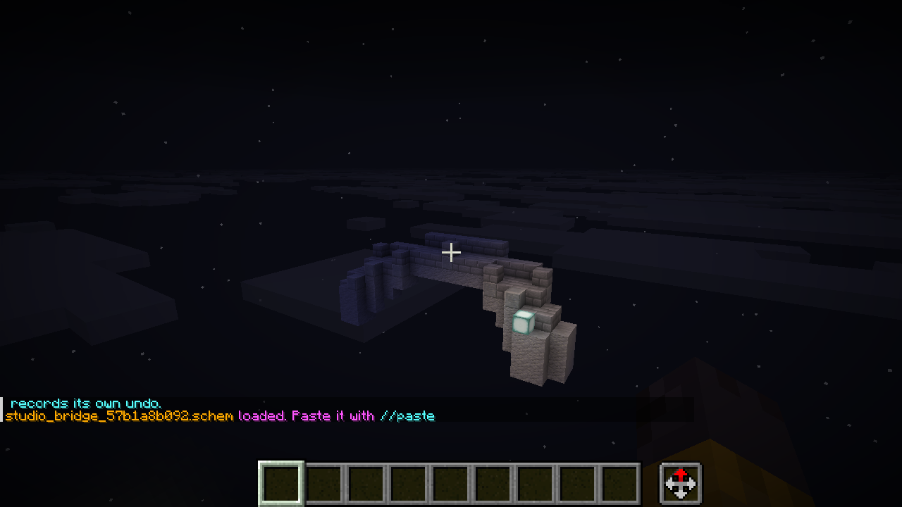
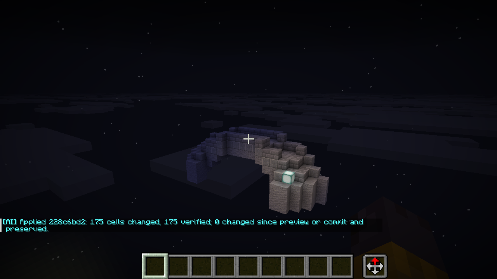
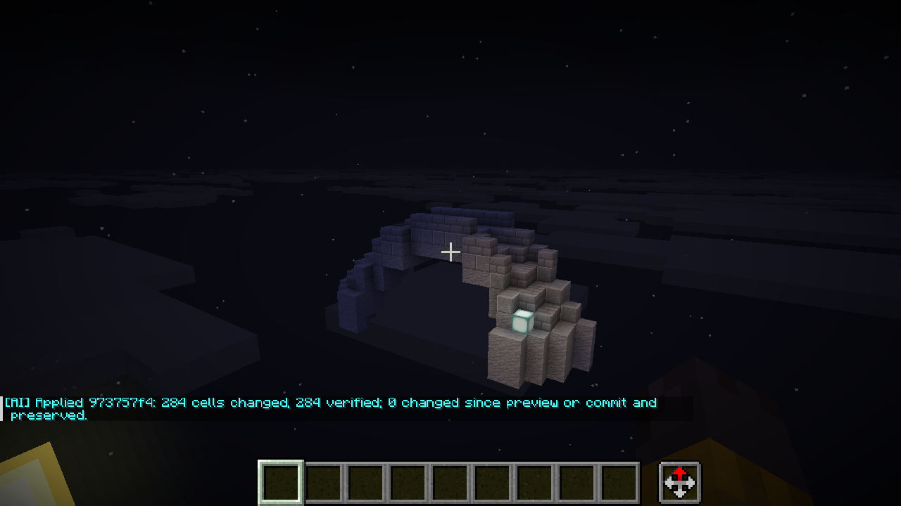
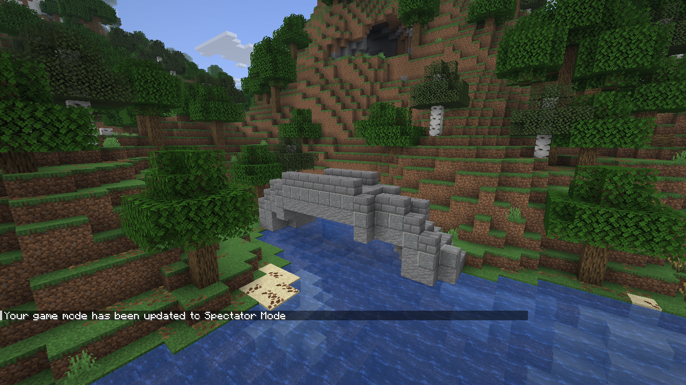

# Milestone 2 — Building fluency

Completed November 25, 2026 on Fabric 26.3. Studio can build and revise a tower or a curved bridge from in-game chat, preserve hand edits during revisions and undo, and export either design to WorldEdit. The tower and bridge use the same geometry library and edit journal. [Matched backend timings and call counts](../benchmarks/README.md#fresh-structures-and-architectural-revisions)

## Build a curved bridge

Aim at solid ground at one landing, press **J → Mark this block**, and name it **West Bank**. Repeat at the other landing with **East Bank**. Leave the markers as named points. Selecting them as opposite corners would restrict the arch to that box.

1. **J → Ask Studio…** and enter **“Preview a curved stone bridge between West Bank and East Bank, three blocks wide with a two-block arch.”** Particles show its path and the HUD reports the proposed change count.
2. Ask **“Build a curved stone bridge between West Bank and East Bank, three blocks wide with a two-block arch.”**
3. Ask **“Widen this bridge to five blocks”** or **“Raise this bridge’s arch by two blocks.”** Studio stores the span and dimensions, checks the old design against the world and applies the eligible differences. The two named landing blocks stay outside the design.
4. Use **@studio undo** to reverse the latest Studio edit. A differing block placed by hand remains protected.

The horizontal span is 6–48 blocks. Width is 3, 5, 7 or 9 blocks. Arch rise is 1–8 blocks and signed bend is −8 through +8 blocks at midspan. Positive bend offsets a west-to-east span toward the south. Steep spans require a lower arch or more distance between the banks. Moving a marker later leaves existing bridge geometry at its original coordinates.

### Use WorldEdit for a fresh placement

After a Studio preview, send **@studio export preview schematic** to save the full proposed design without applying it. To export an existing registered bridge or tower, aim at it and send **@studio export schematic**. Studio returns a unique filename in the instance’s WorldEdit schematics directory. In an empty destination, load the file with **//schem load FILENAME.schem**, then **//paste -a** to place its occupied blocks relative to your placement point. Use **//undo** for this paste.

Exports contain the generated design. A hand-built addition stays in the original world. A WorldEdit paste has WorldEdit history and can replace occupied destination blocks. Studio chat revisions use the guarded editor and its own undo history.

### In-game acceptance

The Fabric 26.3 chat case previewed the bridge without writing, built 172 blocks, widened it from three blocks to five with 175 changes, then raised its arch two blocks with 284 changes. Each design request took one model turn. A sea lantern placed in the path of the widening survived. Three Studio undos restored the original 9,234-cell volume and edit history. WorldEdit loaded the exported design. An earlier planning request timed out before it wrote any blocks; the repeated case passed. [Chat and readback receipt](bridge-chat-results.json)

| Initial deck | Wider deck | Raised arch |
| --- | --- | --- |
|  |  |  |

The second site crossed a river between two grass banks 18 blocks apart. In-game chat produced the preview and exported it before construction. WorldEdit loaded that file. The subsequent build request timed out during planning, so the screenshot shows a replay of the exact preview through Studio’s guarded editor. It placed 218 blocks and protected 81 occupied cells. Undo verified all 218 direct writes. A separate terrain scan found one grass block had changed beneath the bridge during the trial. Studio undo covers its recorded writes and does not rewind Minecraft’s environmental updates.

## First slice · Parametric tower revisions

Open World Studio, press **J → Ask Studio…**, and ask **“Make the hillside watchtower roof four blocks taller. Keep its walls and doorway exactly as they are.”** To see its dimensions and estimated change count first, begin with **preview**.

Follow with **“Move the entrance to the opposite side. Keep the roof as it is.”** The first revision changes the cap. The second closes the old doorway and cuts a matching arch in the new face. You can also name a cardinal direction or ask for a wider base. **@studio undo** reverses the last applied revision.

The TypeScript module generates the hollow shaft and cap from circular cross-sections, subtracts the entrance and windows, and assigns materials. Changing the entrance rotates the opening independently of the roof finish. The Minecraft adapter compares the old design, new design and live blocks. A hand edit that differs from the old design stays protected. The existing brown hillside repaint can supply the expected finish when its recorded writes account for the entire generated cap.

In the Fabric 26.3 acceptance run, a copper test roof grew from six to ten blocks high. Studio verified 131 changed cells, all in the roof. Relocating the north doorway to the south changed 28 cells in the lowest five courses. A sea lantern placed at the original crown survived both revisions and their undos. The 5,400-cell test volume and prior edit history were restored. [Exact chat, counts and timings](parametric-tower-results.json)

[Geometry source](../packages/geometry/tower.ts) · [Building controls](in-game-building.md) · [Testing](testing.md)

The matching north views replay the verified designs in the disposable world with the same manual lantern. The arch below the roof is a reference for scale.

| Six-block roof | Ten-block roof |
| --- | --- |
|  |  |

## Execution and verification

The [geometry SDK](../packages/geometry) includes circular lofts, quadratic Bézier curves, swept profiles, vertical polygon extrusion, union, intersection and subtraction. The tower and bridge share geometry operations, a common world adapter and the same guarded edit journal. [Acceptance procedure](testing.md) · [Backend trials](../benchmarks/README.md)

[Milestone 1 implementation and human acceptance](milestone-1.md) · [Product roadmap](roadmap.md)
