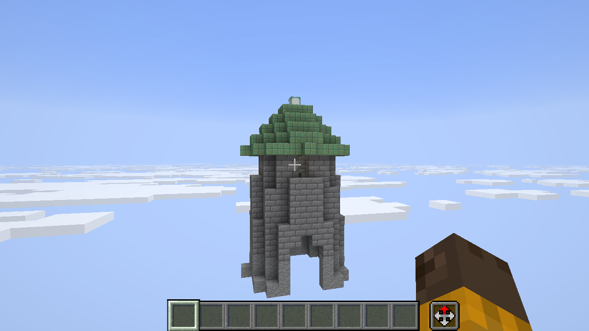

# Milestone 2 — Building fluency

## First slice · Parametric tower revisions

Open World Studio, press **J → Ask Studio…**, and ask **“Make the hillside watchtower roof four blocks taller. Keep its walls and doorway exactly as they are.”** To see its dimensions and estimated change count first, begin with **preview**.

Follow with **“Move the entrance to the opposite side. Keep the roof as it is.”** The first revision changes the cap. The second closes the old doorway and cuts a matching arch in the new face. You can also name a cardinal direction or ask for a wider base. **@studio undo** reverses the last applied revision.

The TypeScript module generates the hollow shaft and cap from circular cross-sections, subtracts the entrance and windows, and assigns materials. Changing the entrance rotates the opening independently of the roof finish. The Minecraft adapter compares the old design, new design and live blocks. A hand edit that differs from the old design stays protected. The existing brown hillside repaint can supply the expected finish when its recorded writes account for the entire generated cap.

In the Fabric 26.3 acceptance run, a copper test roof grew from six to ten blocks high. Studio verified 131 changed cells, all in the roof. Relocating the north doorway to the south changed 28 cells in the lowest five courses. A sea lantern placed at the original crown survived both revisions and their undos. The 5,400-cell test volume and prior edit history were restored. [Exact chat, counts and timings](parametric-tower-results.json)

[Geometry source](../packages/geometry/tower.ts) · [Building controls](in-game-building.md) · [Testing](testing.md)

The matching north views replay the verified designs in the disposable world with the same manual lantern. The arch below the roof is a reference for scale.

| Six-block roof | Ten-block roof |
| --- | --- |
|  |  |

## Remaining Milestone 2 work

1. Compare grouped, guarded fills with schematic placement on representative fresh builds and small revisions. Measure correctness, recoverability and elapsed time for each.
2. Build a curved bridge between two saved markers. Use it to develop a second caller for shared geometry and test a width or arch-height revision in game.

[Milestone 1 implementation and human acceptance](milestone-1.md) · [Product roadmap](roadmap.md)
