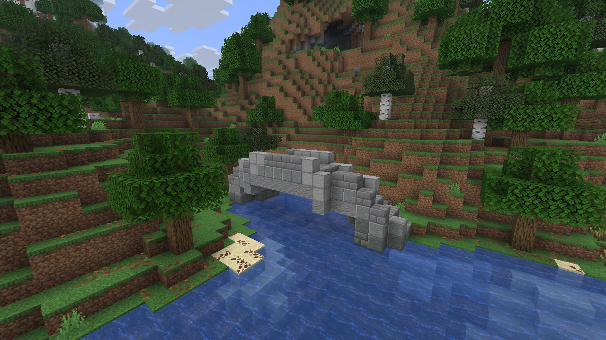
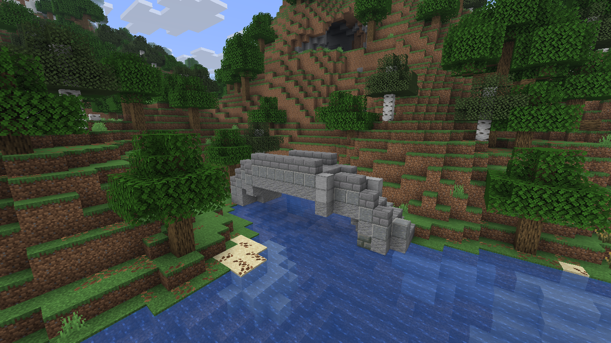

# Milestone 3 — Artistic intelligence

## First slice · Weathered bridge stone

Aim at a registered Studio bridge and use **J → Ask Studio…**. You can also identify a bridge by its two bank names.

1. Ask **“Give this bridge darker, weathered stone near the waterline. Keep the upper stonework lighter and the walking surface quiet. Preserve the shape and my hand-placed blocks.”**
2. Ask **“Make the weathering subtler.”** The strongest parts of the original patches remain, with more of the original stone showing through.
3. Use **@studio undo** to return to the stronger finish. A second undo restores the original stone where the live blocks still match Studio’s work.

The first paint pass surveys water below the actual deck. Low masonry takes on dark tuff brick and polished tuff, while smooth stone catches the light higher up. A shared noise field gives neighboring blocks related values and keeps the patches in place between revisions. The walking lane keeps its original material. Both finishes use the original coordinates and can be exported with the registered bridge. [Material selection](../packages/geometry/materials.ts) · [Building and exporting a bridge](milestone-2.md)

The survey checks down to eight blocks below the lower landing. The most frequently observed exposed water elevation becomes the reference for this bridge. A dry crossing gets a quieter foundation treatment. Studio saves the sampled elevation with the finish so later edits can reproduce it.

### River crossing playtest

Studio built the bridge through chat and found water at Y62. The full finish changed 58 of its 218 placed blocks. Tuff bricks and polished tuff averaged Y63.3, while smooth stone averaged Y67.1. The subtler pass kept 16 of those accents in place and restored 42 blocks to their original material. Both undos preserved the cut copper at the west landing. The fixture placed that block with a conditional Minecraft command to simulate a hand edit. An independent readback checked all 4,914 cells after each revision and confirmed the river was restored after cleanup. [Exact chat, palette counts and undo results](bridge-weathering-results.json)

| Original | Weathered | Subtle |
| --- | --- | --- |
|  |  |  |

## Remaining artistic work

The broader milestone includes reference palettes, evaluation from multiple views, terrain blending and personal style preferences. The bridge provides the first in-game example for judging a palette on existing architecture. [Roadmap](roadmap.md)
