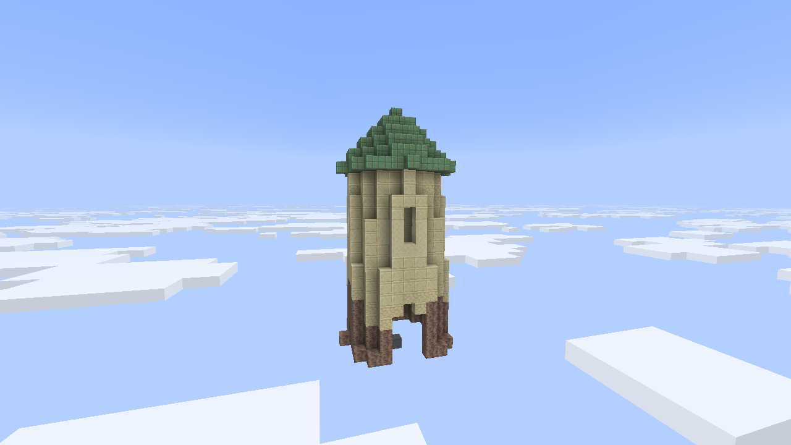
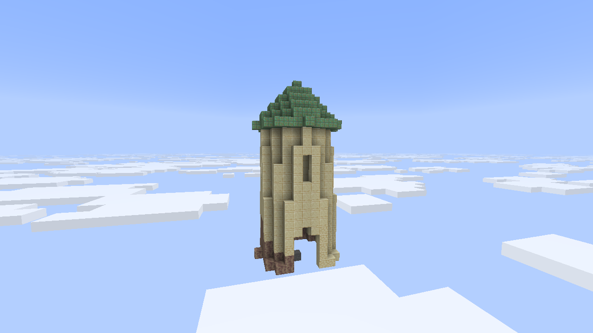
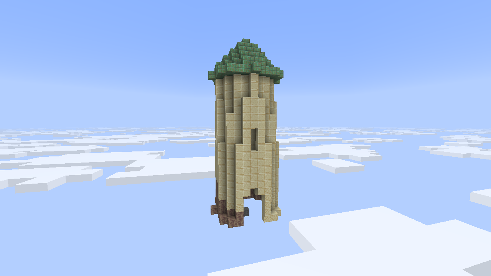

# Painterly tower playtest

The player asked for a warm limestone tower in the disposable Fabric 26.3 Overworld. The real Codex listener interpreted the chat, the geometry package selected the blocks, and the checked editor read the result back from Minecraft. Each stage compared 6,750 cells, including air around the building. A conditional placement of cut copper simulated a hand edit at a location the repaint would otherwise change. [Exact chat, recipes, block counts and camera positions](painterly-chat-results.json) · [Rerunnable scenario](../experiments/painterly-foundation.mjs)

| Balanced masonry | Quiet masonry | Quiet masonry, taller |
| --- | --- | --- |
|  |  |  |

The balanced version anchors both sides of the entry with brown stone. The quiet revision opens up a pale patch on the right pier and leaves the darker weight on the left. The window still reads from a distance. Its pale border and the dark slit attract more attention than the narrow doorway below. This is a concrete next refinement if the entrance should dominate. The floating plot isolates the facade and gives little evidence about its fit in a landscape.

| Stage | Result |
| --- | --- |
| Create | 519 blocks verified. The saved brief named the north entrance as the focal point. |
| Quiet the walls | 158 blocks verified. Across 381 eligible wall blocks, accent blocks fell from 204 to 87. Unlike adjacent pairs fell from 116 to 54. The copper hand edit, roof and openings survived. |
| Review | Codex received a 1280 × 720 PNG from the current player view. It identified the green roof against the warm stone and suggested lowering the window surround's contrast. Full-volume and history comparisons confirmed a read-only turn. |
| Raise the wall | From 16 to 20 blocks, 414 changed cells verified. The object kept its complete v2 art direction, including mood, focal point and semantic regions. |
| Undo and control | Checked undo restored each prior state, including the hand edit. An ordinary functional tower used the standard stone recipe. The fixture removed its own temporary supports and restored the pose. |

A second live run saved the quiet treatment as project style v1, removed the source tower, then built two new towers in turn. A functional request used ordinary stone. An explicit project-style match reproduced the quiet limestone across 518 eligible cells and preserved the one hand-placed copper block. The copy started at art revision 1, with its source recorded as project style v1. [Separate playtest receipt](painterly-project-style-results.json)

In a separate placement, the source tower and a styled copy stood twenty blocks apart. Restoring the previous project style changed zero of 9,009 surveyed cells, and both object registrations and the edit history stayed intact. [Two-tower verification](painterly-style-restore.json)

**Additional views.** The near and far pairs show how the difference reads while walking toward the tower. The matched medium shots used the same camera and recorded world time. Clouds continued moving. Material transition counts measure local busyness. Compare the views to judge which facade better serves the entrance. [Balanced near](../screenshots/painterly-balanced-near.png) · [Quiet near](../screenshots/painterly-quiet-near.png) · [Balanced far](../screenshots/painterly-balanced-far.png) · [Quiet far](../screenshots/painterly-quiet-far.png) · [Exact input frame for critique](../screenshots/painterly-critique-input.png)

Offline regressions cover both generated subjects, all three palettes, all texture levels, protected block states, wet marks and light direction. The three palette families have static measurements from the default 26.3 client assets. The screenshots on this page exercise warm limestone in game. The optional sampler tests check a black/white reference in linear light, texture-pack precedence and unsupported animated or multipart assets. Run them with `python experiments/test_palette_metadata.py` in the Pillow environment. [Material tests](../packages/geometry/painterly-materials.test.mjs) · [Benchmark plan and scope](painterly-building.md)
